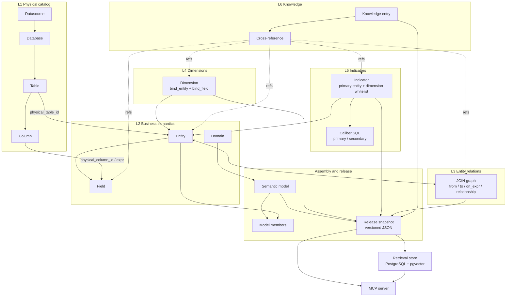

# CodataAdmin

> An enterprise semantic governance and trusted query platform: model the physical warehouse as a layered semantic ontology, publish reviewed snapshots, and expose caliber-backed answers to AI agents over MCP.

English | [简体中文](./README.md)

> **Companion project**: This repository is the semantic-model companion to the [Codata](https://github.com/Mlilion/Codata) project, focused on semantic modeling, release snapshots, and trusted querying over MCP. See [Mlilion/Codata](https://github.com/Mlilion/Codata) for the platform and agent capabilities.

## Online Demo

The demo URL and demo credentials are shared in the community group. Scan the QR code in [Contact](#contact) to join and request access. If the group QR code has expired, add the author on WeChat for an invitation.

## Positioning

CodataAdmin is not an admin template. Its core is the **semantic model**. It answers three questions:

1. What does a business term such as "subscription revenue" or "active users" actually map to in the physical warehouse?
2. Which caliber defines the number, who maintains it, and what changes when it is edited?
3. How can an AI agent obtain an explainable, auditable number without writing SQL or guessing a caliber?

The platform provides one continuous path:

**Physical catalog → layered semantic ontology → model assembly → release snapshot → retrieval index → MCP querying → audit loop**

Users, roles, tenants, and menus exist only as the operational substrate for this governance flow.

## Semantic ontology

The semantic center organizes assets into L1–L6 layers (the `OneData ontology` layering used in the code). A semantic model is the unit that assembles and publishes these assets.



### Layer responsibilities

| Layer | Objects (tables) | Purpose | Key fields / constraints |
|---|---|---|---|
| **L1 Physical catalog** | `cat_datasource` / `cat_database` / `cat_table` / `cat_column` | Real warehouse metadata, synced from DataCatalog or collected by the platform (StarRocks / MySQL / Redshift) | Datasource → database → table → column hierarchy; tables and columns are the anchors for semantic binding |
| **L2 Domain** | `sem_domain` | Business classification and governance grouping for models | `code`, `name`, enabled status |
| **L2 Entity** | `sem_entity` | Business wrapper over a physical table; the foundation of the ontology | `physical_table_id` soft FK to L1; `entity_type` = fact / dimension / detail / summary; `grain`; `default_time_field`; becomes orphaned when the physical table disappears |
| **L2 Field** | `sem_field` | Gives a physical column or expression business meaning | `physical_column_id` or `expr`; `field_role` = measure / dimension / time / id; `visibility` = public / internal / hidden; `enum_values` drives filter validation |
| **L3 Join** | `sem_join` | Builds the JOIN graph used by query compilation | `from_entity_id`, `to_entity_id`, `on_expr`, `relationship_type`, `join_type` |
| **L4 Dimension** | `sem_dimension` | A drill-down dimension | `bind_entity_id` + `bind_field_code` point to the entity field where the dimension lives |
| **L5 Indicator** | `sem_indicator` + `sem_indicator_impl` | Business indicators and their authoritative SQL calibers | `indicator_type` = atomic / derived / composite; `primary_entity_id`; `available_dimension_ids` whitelist; calibers are `primary` / `secondary` and must be approved before entering a snapshot |
| **L6 Knowledge** | `sem_knowledge` + `sem_knowledge_ref` | Business context, usage notes, and caveats | Types = background / usage / caveat / query_pattern / glossary; `usage_mode` = always / auto / never; `caliber_break_date`; refs can target any semantic node |
| **Assembly** | `sem_model` + `sem_model_entity` + `sem_model_grant` | The semantic model is the **smallest unit of release and consumption** | Member role = primary / related; `visibility` = public / restricted, with per-user grants when restricted |
| **Release** | `sem_model_release` | Self-contained JSON snapshot produced on every release | `version` increments per release; `checksum` guards integrity; `node_stats` summarizes contents |

### Ontology relations

- **Entity → physical table**: many-to-one, soft FK. If the physical table is removed, the link is nulled and marked orphaned rather than cascading a delete into semantic assets.
- **Field → physical column**: many-to-one; use `expr` when the field is computed rather than directly mapped.
- **Dimension → entity field**: a dimension must bind to a concrete field on a concrete entity; the binding is validated at release time.
- **Indicator → primary entity + calibers**: an indicator belongs to one primary entity and may own multiple SQL calibers. Only an approved `primary` caliber enters the release snapshot.
- **Knowledge → any node**: one knowledge entry can attach to entities, fields, dimensions, indicators, joins, or the model, and follows its attachment points into the snapshot.
- **Model ↔ entity**: many-to-many. A model includes entities as members; it does not own them, so dimension entities can be reused across models.

## Release: the only gateway into agent visibility

Publishing a semantic model is a compile-and-gate process, not a button:

1. **Assemble the model tree**: choose member entities, mark primary / related, and associate dimensions, indicators, joins, and knowledge.
2. **Completeness checks**: red lights block the release — an entity without a valid physical table, a field without a physical column, a dimension without an entity-field binding, a published indicator without an approved primary caliber, a join with a missing or unpublished endpoint, unpublished knowledge, or a model with no member entities. Yellow lights only warn — missing grain, missing owner, no primary entity, no declared available dimensions, or unpublished entities and indicators.
3. **Compile the snapshot**: include only nodes in the published state; exclude `hidden` fields; include only approved calibers. Knowledge is handled by `usage_mode` — `always` is inlined, `auto` keeps a summary in the index with its body in `knowledge_pool`, and `never` is excluded.
4. **Release audits**:
   - Caliber SQL must not reference columns the model does not declare (otherwise an upstream table change can pass "all green" and fail only at query time).
   - Caliber SQL must be compatible with the current target dialect.
   - Any red light refuses the release. No downgrade, no bypass.
5. **Version bump**: `version + 1`, snapshot and checksum written, model marked as released.
6. **Sync the retrieval index**: compile the new snapshot into the PostgreSQL retrieval store. Index sync failures log a warning but never roll back the release — retrieval is optional augmentation and must not break the main path.

The snapshot is a stable consumption contract:

```json
{
  "model":       { "code": "...", "name": "...", "version": 7, "domain": "...", "default_time_grain": "month" },
  "entities":    [{ "code": "...", "physical": { "datasource": "...", "database": "...", "table": "..." }, "fields": [] }],
  "dimensions":  [{ "code": "...", "bindings": [{ "entity": "...", "field": "..." }] }],
  "indicators":  [{ "code": "...", "primary_entity": "...", "impls": [], "available_dimensions": [] }],
  "joins":       [{ "from_entity": "...", "to_entity": "...", "on_expr": "...", "relationship": "many_to_one" }],
  "model_knowledge": [],
  "knowledge_pool":  {}
}
```

**No release snapshot means no authoritative caliber.** Retrieval skips the model, `hydrate` reports an error, and queries return `model_not_released`.

## Online query path

```text
User question
  → Preprocess: extract the time range
  → Retrieve: locate indicators / dimensions / knowledge
  → Hydrate: load the authoritative caliber from the release snapshot
  → Validate intent: deterministic rules constrain the LLM's freedom
  → Bind / compile: safely inject time range, dimensions, and filters into the caliber SQL
  → Read-only execution: read-only account + LIMIT + EXPLAIN precheck
  → Caliber declaration: return the caliber and warnings alongside every number
```

### Tiered retrieval

The retrieval store is a derived index; MySQL remains the single source of truth. Four tiers score candidates in order, and the highest score wins per node (scores are not summed):

| Tier | Method | Score range |
|---|---|---|
| Exact | code / name / alias equality | 1.00 / 0.97 / 0.93 |
| Fuzzy | ILIKE substring, multi-token AND | 0.70–0.89 |
| Full-text | jieba tokenization + `ts_rank_cd` | 0.50–0.69 |
| Vector | pgvector cosine similarity (optional) | 0.30–0.49 |

Retrieval distinguishes three different "no result" outcomes: **ambiguity** asks the user to specify a code, **out of coverage** returns `rejected`, and **server failure** returns `unavailable`. They are semantically opposite and never conflated.

### Intent validation

The validator is the last gate against hallucination. Deterministic rules constrain the structured intent produced from natural language:

- Dimensions must be in the indicator's available-dimension whitelist.
- Filter values must be in the field's `enum_values`.
- Indicator queries require a time range, preventing full-table scans.
- Draft calibers must never be treated as authoritative.
- A time range crossing a caliber break is refused (aggregating across the break inflates results).
- Order-level / snapshot-level indicators cannot be pushed to the DWD detail layer.
- `order_by`, `top_n`, and `data_layer` each have explicit allowed values and boundaries.

Any failure returns a structured error (`rule` / `message` / `allowed`), so the agent can reflect or ask the user instead of running a wrong SQL statement.

### Cross-entity drill-down

A dimension does not have to live on the indicator's primary entity. The system follows a registered `sem_join` relation for **one hop** and rebuilds the SQL while preserving the caliber conditions. This path refuses rather than guesses:

- `SUM` / `AVG` / `COUNT(*)` across a one-to-many relation → `fanout_refused` (row amplification inflates the number while the SQL reports success);
- Calibers containing CTEs, subqueries, multiple tables, multiple aggregates, or their own `GROUP BY` → `not_decomposable`;
- Multi-hop, multiple cross-entity dimensions, or cross-entity dimensions combined with filters → explicit refusal.

**A refusal is an answer.** It means "this number would be wrong when split by this dimension." Substituting a similarly named indicator is worse than returning a failure.

## MCP tools

The MCP server exposes Streamable HTTP at `/mcp`. Standard flow:

```text
list_models → search_semantic → get_model_context → query_indicator
                                                    └→ execute_sql (exploration only)
```

| Tool | Purpose | Key constraints |
|---|---|---|
| `list_models` | List released models and their `model_id` | Only released models, filtered by caller visibility |
| `search_semantic` | Search indicators, dimensions, knowledge, entities, fields | Never guess codes; returns `needs_clarify` / `not_buildable` / `ambiguous` / `rejected` / `unavailable` |
| `get_model_context` | Load authoritative calibers, allowed dimensions, physical locations, and knowledge from the release snapshot | Reads the snapshot, never live tables, so draft edits cannot drift the caliber |
| `query_indicator` | Bind parameters into an approved caliber and execute read-only | Parameters constrained by whitelists and enums; returns a `caliber` declaration |
| `execute_sql` | Execute agent-written read-only SQL | **Disabled by default**; results carry no caliber endorsement and must not answer business-number questions |

Authentication and isolation: an MCP token can be bound to a platform user. `public` models are visible to all callers; `restricted` models are visible only to the owner, granted users, and super admins. Unauthorized access always returns `model_forbidden` without revealing whether the model exists.

## Semantic center (web console)

| Page | Contents |
|---|---|
| Physical catalog | Datasources / databases / tables / columns; DataCatalog sync and self-collection |
| Domains | Semantic classification and governance grouping |
| Entities | Entities, fields, physical bindings, grain, lifecycle |
| Semantic models | Model-tree assembly, completeness, release, versions, user grants |
| JOIN relations | Entity relation registration and graph |
| Indicators | Definitions, caliber SQL, review, available-dimension whitelist |
| Dimensions | Definitions and entity-field bindings |
| Knowledge | Background / usage / caveat / query pattern / glossary, with review and caliber breaks |
| MCP tokens | Issue, revoke, and bind callers |
| Query logs | Retrieval and adoption signals for zero-recall and alias governance |
| Upstream changes | Column add/remove/type change and table removal inbox (bound / sql_ref / table_only) |

An operational readiness endpoint is also available at `GET /api/v1/semantic/retrieval/readiness`. It checks whether any model has been released, whether the index is stale, whether the warehouse is reachable, whether MCP is mounted, and whether high-impact upstream changes are pending. The platform is ready only when `blockers` is empty.

## Stack

| Layer | Technology |
|---|---|
| Backend | FastAPI, SQLAlchemy 2, Alembic, Pydantic v2, Typer, APScheduler, Redis, FastMCP |
| Frontend | Vue 3, Vite 7, TypeScript, Element Plus, Pinia, Tailwind CSS 4, ECharts |
| Main data | MySQL 8 by default; PostgreSQL / SQLite supported by backend settings |
| Retrieval | Optional PostgreSQL + pgvector, jieba tokenization, OpenAI-compatible embeddings |
| Integrations | DataCatalog sync, third-party OAuth, MCP tools |

Retrieval, embeddings, DataCatalog sync, and MCP access are optional. Without them the platform can still model, release, and govern assets; retrieval degrades to `always`-mode knowledge only.

## Quick start

### Requirements

- Python 3.12+ with uv
- Node.js 20.19+ with pnpm 9.x
- MySQL 8.0+ and Redis

### Run

```bash
# Backend
cp backend/env/.env.dev.example backend/env/.env.dev
cd backend
uv sync
uv run main.py init-db --env=dev      # initialize tables and seed data
uv run main.py run --env=dev
```

```bash
# Frontend
cp frontend/web/.env.example frontend/web/.env
cd frontend/web
corepack enable
pnpm install
pnpm dev
```

Open `http://127.0.0.1:5180/web/#/login`. Development demo accounts are `super` / `admin` / `user` with password `123456`, for local use only. Production initialization requires an `INITIAL_ADMIN_PASSWORD` of at least 16 characters before first startup.

When the retrieval store is enabled, initialize its schema:

```bash
cd backend
uv run main.py init-retrieval --env=dev
```

For Docker deployment, Nginx, and production settings, see [docker/README.md](docker/README.md) and the root `deploy.sh`.

## Semantic settings

| Setting | Default | Description |
|---|---|---|
| `SEMANTIC_RETRIEVAL_ENABLE` | `False` | Master switch for the retrieval store; when off, only `always` knowledge is used |
| `SEM_PG_HOST` / `SEM_PG_PORT` / `SEM_PG_DB` | `localhost` / `5433` / `semantic_retrieval` | Retrieval store connection |
| `SEM_RETRIEVAL_FTS_ENABLE` | `True` | jieba + `tsvector` full-text tier |
| `SEM_RETRIEVAL_VECTOR_ENABLE` | `False` | pgvector tier; requires `AI_EMBEDDING_ENABLE` |
| `AI_EMBEDDING_*` | — | OpenAI-compatible embedding endpoint, model, and dimensions |
| `SEM_QUERY_DIALECT` | `starrocks` | Warehouse dialect: starrocks / mysql / redshift |
| `SEM_QUERY_HOST` / `SEM_QUERY_PORT` / `SEM_QUERY_USER` / `SEM_QUERY_PASSWORD` | — | Read-only warehouse connection; Redshift usually uses port 5439 |
| `SEM_QUERY_MAX_ROWS` / `SEM_QUERY_TIMEOUT` | `500` / `60` | Row guard and query timeout |
| `SEM_RAW_SQL_ENABLE` | `False` | Enables agent-written SQL; exposes every table the warehouse account can read |
| `SEM_MCP_ENABLE` | `True` | Mount `/mcp` |
| `SEM_MCP_TOKEN` / `SEM_MCP_TOKENS` | — | MCP tokens; a non-dev environment without one refuses to mount |
| `SEM_MCP_PUBLIC_URL` | — | Public MCP URL |
| `DATACATALOG_BASE_URL` / `DATACATALOG_USERNAME` / `DATACATALOG_PASSWORD` | — | DataCatalog sync |

> The boundary for `SEM_RAW_SQL_ENABLE` is the warehouse account's grants, not the application layer. Do not enable it if you rely on model-level visibility for data isolation.

## Layout

```txt
.
├── backend/
│   ├── app/api/v1/module_semantic/   # semantic center: catalog, domain, entity, join, dimension, indicator, knowledge, model, retrieval, MCP
│   ├── app/scripts/data/             # seed data
│   └── docs/                         # semantic deployment checklist and MCP docs
├── frontend/web/                     # Vue 3 web console (semantic center pages)
├── frontend/app/                     # reserved mobile directory
├── frontend/docs/                    # reserved docs directory
├── docker/                           # Compose, MySQL/Redis/PostgreSQL, Nginx
├── docs/images/                      # README images (community and author QR codes)
└── deploy.sh                         # one-command deployment
```

Key semantic subdirectories:

```txt
backend/app/api/v1/module_semantic/
├── catalog/      # L1 physical catalog, DataCatalog sync, upstream changes
├── domain/       # domains
├── entity/       # entities and fields
├── join/         # entity relations
├── dimension/    # dimensions
├── indicator/    # indicators and SQL calibers
├── knowledge/    # knowledge entries and cross-references
├── model/        # model assembly, completeness, release snapshots
├── retrieval/    # retrieval, hydrate, validation, parameter binding, JOIN compilation, read-only execution
└── mcp/          # MCP server and authentication
```

## Docs

- [Backend](backend/README.md)
- [Frontend Web](frontend/web/README.md)
- [Docker Deployment](docker/README.md)
- [Semantic Deployment Checklist](backend/docs/semantic-deploy-checklist.md)
- [MCP Integration and Query Rules](backend/docs/semantic-mcp.md)
- [Feishu OAuth](backend/docs/feishu-oauth.md)

## License

This project is licensed under GNU GPL v3.0 (GPL-3.0-only). See [LICENSE](./LICENSE).

## Deployment notes

- Do not reuse initial accounts, default passwords, or sample secrets in production.
- The main database is initialized from ORM models and JSON seed files; the retrieval store is a rebuildable derived index, not a source of truth.
- Semantic models must be released before MCP tools can list or consume them.
- Release gates and readiness checks are two separate defenses: the first blocks what cannot enter a snapshot, the second answers whether the platform is usable right now.

## Contact

Join the community to discuss semantic modeling, ask questions, or report issues.

- **Codata Agent group**: Scan to join. The QR code is valid for 7 days; if it has expired, add the author on WeChat and they will invite you to the group.
- **Author on WeChat**: Scan to add, mention "Codata", and the author will invite you to the group.

<table>
  <tr>
    <td align="center" width="50%"><br/><sub>Codata Agent group</sub></td>
    <td align="center" width="50%"><br/><sub>Author WeChat (moilion)</sub></td>
  </tr>
</table>
