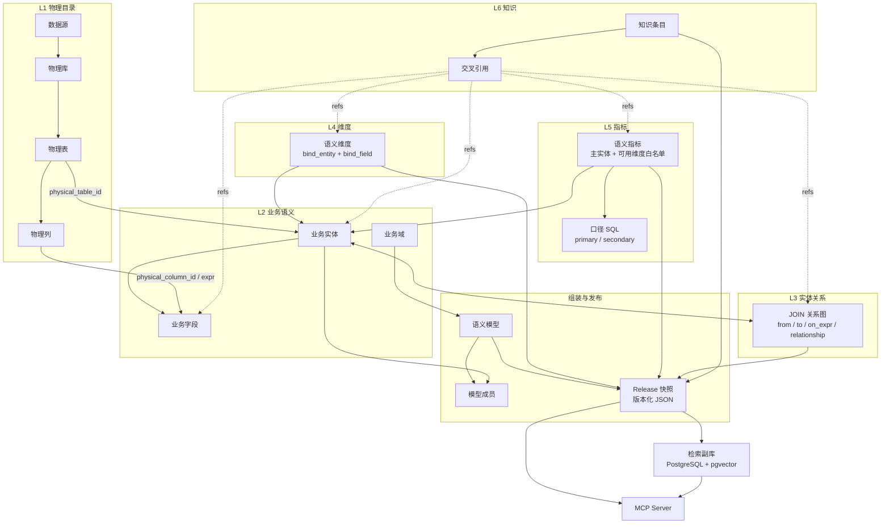

# CodataAdmin

> 企业级语义治理与可信取数平台：把物理数仓建模为分层语义本体，经人工审核与发布快照后，通过 MCP 向 AI Agent 提供有口径背书的取数能力。

简体中文 | [English](./README.en.md)

> **配套项目**：本仓库是 [Codata](https://github.com/Mlilion/Codata) 项目的配套语义模型项目，专注语义建模、发布快照与 MCP 可信取数；平台与 Agent 能力请见 [Mlilion/Codata](https://github.com/Mlilion/Codata)。

## 在线体验 Demo

在线体验地址及体验账号在交流群内提供，请前往[联系方式](#联系方式)扫码进群获取。若群二维码已过期，可添加作者微信，由作者邀请入群。

## 项目定位

CodataAdmin 的核心不是后台管理，而是**语义模型**。它要回答三个问题：

1. 业务语言里的「订阅收入」「活跃用户」在物理数仓里到底对应什么？
2. 这个数字按什么口径计算、由谁维护、改完会影响谁？
3. AI Agent 如何在不写 SQL、不猜口径的前提下，拿到可解释、可审计的数字？

平台围绕这三个问题提供一条完整链路：

**物理目录 → 分层语义本体 → 语义模型组装 → 发布快照 → 检索索引 → MCP 取数 → 审计闭环**

用户、角色、租户、菜单等后台能力只作为治理流程的运行底座，不是本项目的主体。

## 语义本体架构

语义中心按 L1–L6 分层组织（代码中的 `OneData 本体` 分层），语义模型是这些资产的组装与发布单元。



### 分层职责

| 层 | 对象（表） | 作用 | 关键字段 / 约束 |
|---|---|---|---|
| **L1 物理目录** | `cat_datasource` / `cat_database` / `cat_table` / `cat_column` | 物理数仓的真实元数据，可从 DataCatalog 同步，也可由平台自主采集（StarRocks / MySQL / Redshift） | 数据源、库、表、列的层级关系；表/列是语义绑定的锚点 |
| **L2 业务域** | `sem_domain` | 业务分类，也是语义模型的治理分组 | `code`、`name`、启停状态 |
| **L2 业务实体** | `sem_entity` | 物理表的业务化封装，是本体的地基 | `physical_table_id` 软挂钩 L1；`entity_type` = fact / dimension / detail / summary；`grain` 声明粒度；`default_time_field`；物理表删除后置为 orphan |
| **L2 业务字段** | `sem_field` | 给物理列或计算式赋予业务含义 | `physical_column_id` 或 `expr`；`field_role` = measure / dimension / time / id；`visibility` = public / internal / hidden；`enum_values` 供过滤值域校验 |
| **L3 实体关系** | `sem_join` | 构成 JOIN 图，供查询编译自动找路径 | `from_entity_id`、`to_entity_id`、`on_expr`、`relationship_type`、`join_type` |
| **L4 维度** | `sem_dimension` | 可下钻的分析维度 | `bind_entity_id` + `bind_field_code` 指向维度落在哪个实体的哪个字段 |
| **L5 指标** | `sem_indicator` + `sem_indicator_impl` | 业务指标及其权威 SQL 口径 | `indicator_type` = atomic / derived / composite；`primary_entity_id`；`available_dimension_ids` 可用维度白名单；口径分 `primary` / `secondary`，必须审核通过才能进快照 |
| **L6 知识** | `sem_knowledge` + `sem_knowledge_ref` | 指标背后的业务背景、用法与避坑说明 | 类型 = background / usage / caveat / query_pattern / glossary；`usage_mode` = always / auto / never；`caliber_break_date` 口径分水岭；refs 可挂到任意语义节点 |
| **组装层** | `sem_model` + `sem_model_entity` + `sem_model_grant` | 语义模型是**发布与消费的最小单元**，圈定一组实体构成分析场景 | 成员角色 = primary / related；`visibility` = public / restricted，restricted 时按模型逐人授权 |
| **发布层** | `sem_model_release` | 每次发布生成的自包含 JSON 快照 | `version` 每次发布 +1；`checksum` 防篡改；`node_stats` 记录节点统计 |

### 本体关系

- **实体 → 物理表**：多对一，软外键；物理表被删除时置空并标记 orphan，而不是级联删除语义资产。
- **字段 → 物理列**：多对一；非直接映射时用 `expr` 保存计算式。
- **维度 → 实体字段**：维度必须绑定到具体实体上的具体字段，发布时校验绑定是否仍有效。
- **指标 → 主实体 + 口径**：一个指标归属一个主实体，可有多条 SQL 口径；只有 `primary` 且审核通过的口径会进入发布快照。
- **知识 → 任意节点**：一条知识可同时挂到实体、字段、维度、指标、JOIN 或模型上，发布时跟随挂载位置进入快照。
- **模型 ↔ 实体**：多对多，模型只圈成员、不拥有实体，因此维表实体可被多个模型复用。

## 发布：进入 Agent 视野的唯一入口

语义模型发布不是一个按钮，而是整条链路的编译与门禁：

1. **组装模型树**：选定成员实体，标记 primary / related，关联维度、指标、JOIN 与知识。
2. **完整度检查**：红灯阻断发布——实体未绑定有效物理表、字段未绑定物理列、维度未绑定实体字段、已发布指标无审核通过的主口径、JOIN 端点缺失或未发布、知识未发布、模型无成员实体；黄灯仅提示——缺粒度、缺负责人、未设主实体、未声明可用维度、实体或指标未发布等。
3. **编译快照**：只收录「已发布」状态的节点；`hidden` 字段不进入快照；只带审核通过的口径；知识按 `usage_mode` 处理——`always` 内联全文、`auto` 留摘要索引并把正文放入 `knowledge_pool`、`never` 不进快照。
4. **发布审计**：
   - 口径 SQL 不得引用模型未声明的列（防止上游改表后发布「全绿」、取数才报错）；
   - 口径 SQL 必须兼容当前目标方言；
   - 任一红灯都会拒绝发布，不降级、不放行。
5. **版本递增**：`version + 1`，写入快照与 checksum，模型状态置为已发布。
6. **同步检索索引**：把新快照编译进 PostgreSQL 检索副库。索引同步失败只告警，不回滚发布——检索是可选增强，不能拖垮主链路。

发布快照的结构是稳定的消费契约：

```json
{
  "model":       { "code": "...", "name": "...", "version": 7, "domain": "...", "default_time_grain": "month" },
  "entities":    [{ "code": "...", "physical": { "datasource": "...", "database": "...", "table": "..." }, "fields": [] }],
  "dimensions":  [{ "code": "...", "bindings": [{ "entity": "...", "field": "..." }] }],
  "indicators":  [{ "code": "...", "primary_entity": "...", "impls": [], "available_dimensions": [] }],
  "joins":       [{ "from_entity": "...", "to_entity": "...", "on_expr": "...", "relationship": "many_to_one" }],
  "model_knowledge": [],
  "knowledge_pool":  {}
}
```

**没有发布快照，就没有权威口径。** 检索会跳过该模型，`hydrate` 会报错，取数会返回 `model_not_released`。

## 在线取数链路

```text
用户问题
  → 预处理：剥离时间窗
  → 检索：定位指标 / 维度 / 知识
  → hydrate：从 Release 快照取权威口径
  → 意图校验：确定性规则夹住 LLM 的自由度
  → 填参 / JOIN 编译：把时间窗、维度、过滤条件安全地放进口径 SQL
  → 只读执行：只读账号 + LIMIT + EXPLAIN 预检
  → 口径声明：返回数字时必须同时返回口径与风险提示
```

### 分级检索

检索副库是派生索引，主库 MySQL 仍是唯一事实源。索引按四级递进打分，同一节点多路命中取最高分、不累加：

| 级别 | 手段 | 分数区间 |
|---|---|---|
| 精确 | code / name / 别名等值 | 1.00 / 0.97 / 0.93 |
| 模糊 | ILIKE 子串，多 token AND | 0.70–0.89 |
| 全文 | jieba 分词 + `ts_rank_cd` | 0.50–0.69 |
| 向量 | pgvector 余弦相似度（可选） | 0.30–0.49 |

检索明确区分三种「没有结果」：**候选歧义**要求用户用 code 指定；**覆盖范围外**返回 `rejected`；**服务端故障**返回 `unavailable`。三者语义相反，绝不混为一谈。

### 意图校验

校验器是幻觉的最后一道闸，用确定性规则约束自然语言转出的结构化意图：

- 维度必须在该指标的可用维度白名单内；
- 过滤值必须落在字段的 `enum_values` 内；
- 指标类查询必须有时间窗，防止全表扫描；
- 草稿口径不得被当作权威口径使用；
- 时间窗跨越口径分水岭时拒绝（跨分水岭汇总会虚高）；
- 订单级 / 快照级指标不得误用 DWD 明细层；
- `order_by` / `top_n` / `data_layer` 都有明确的合法取值与边界。

任一规则不通过，返回结构化错误（`rule` / `message` / `allowed`），让 Agent 反思或向用户澄清，而不是放行一条错 SQL。

### 跨实体下钻

维度可以不在指标的主实体上。系统会按 `sem_join` 中登记的关系自动关联**一跳**并重建 SQL，口径条件原样保留。这条路宁可拒绝，也不猜：

- 经一对多关系做 `SUM` / `AVG` / `COUNT(*)` → `fanout_refused`（行数放大，数字会虚增且 SQL 不报错）；
- 口径含 CTE、子查询、多表、多聚合或自带 `GROUP BY` → `not_decomposable`；
- 多跳、多个跨实体维度、跨实体维度叠加过滤 → 显式拒绝。

**拒绝就是答案。** 这些错误表示「这个数按这个维度拆出来会是错的」，换相近指标凑数比返回失败更糟。

## MCP 工具

MCP Server 以 Streamable HTTP 暴露在 `/mcp`，标准流程：

```text
list_models → search_semantic → get_model_context → query_indicator
                                                    └→ execute_sql（仅探索/核对）
```

| 工具 | 作用 | 关键约束 |
|---|---|---|
| `list_models` | 列出已发布的语义模型与 `model_id` | 只列已发布模型，并按调用方可见性过滤 |
| `search_semantic` | 检索指标、维度、知识、实体、字段 | 不猜 code；返回 `needs_clarify` / `not_buildable` / `ambiguous` / `rejected` / `unavailable` |
| `get_model_context` | 从发布快照取权威口径、可用维度、物理位置、口径知识 | 不读活表，避免草稿改动导致口径漂移 |
| `query_indicator` | 用已审核口径填参后只读执行 | 参数受白名单与枚举约束；返回 `caliber` 口径声明 |
| `execute_sql` | 执行 Agent 自己写的只读 SQL | **默认关闭**；结果无口径背书，不得用于回答业务数字 |

鉴权与隔离：MCP Token 可绑定平台用户；`public` 模型对所有调用方可见，`restricted` 模型仅模型负责人、被授权用户与超管可见。越权统一返回 `model_forbidden`，不暴露模型是否存在。

## 语义中心（Web 管理台）

| 页面 | 内容 |
|---|---|
| 物理目录 | 数据源 / 库 / 表 / 列，DataCatalog 同步与自采集 |
| 业务域 | 语义分类与模型治理分组 |
| 业务实体 | 实体、字段、物理绑定、粒度、生命周期 |
| 语义模型 | 模型树组装、完整度检查、发布、版本与用户授权 |
| JOIN 关系 | 实体间关系登记与关系图 |
| 指标管理 | 指标定义、口径 SQL、审核、可用维度白名单 |
| 维度管理 | 维度定义与实体字段绑定 |
| 知识库 | 背景 / 用法 / 避坑 / 查询范式 / 术语，含复核与口径分水岭 |
| MCP 令牌 | 签发、吊销与调用方绑定 |
| 查询日志 | 检索与采纳信号，用于发现零召回和补别名 |
| 上游变更 | 物理列增删改、表删除的影响待办（bound / sql_ref / table_only） |

此外提供运维自检接口 `GET /api/v1/semantic/retrieval/readiness`：检查模型是否发布、索引是否过期、数仓是否连通、MCP 是否挂载、是否有高影响上游变更。`blockers` 为空才算就绪。

## 技术栈

| 层 | 技术 |
|---|---|
| 后端 | FastAPI、SQLAlchemy 2、Alembic、Pydantic v2、Typer、APScheduler、Redis、FastMCP |
| 前端 | Vue 3、Vite 7、TypeScript、Element Plus、Pinia、Tailwind CSS 4、ECharts |
| 主库 | 默认 MySQL 8；配置层支持 PostgreSQL / SQLite |
| 描述检索 | 可选 PostgreSQL + pgvector，jieba 分词，OpenAI 兼容嵌入 |
| 集成 | DataCatalog 目录同步、第三方 OAuth、MCP 工具协议 |

语义检索副库、嵌入模型、DataCatalog 同步与 MCP 接入都是可选能力；不开启时平台仍可完成建模、发布与后台治理，只是检索降级为仅使用 `always` 档知识。

## 快速启动

### 环境要求

- Python 3.12+ 与 uv
- Node.js 20.19+ 与 pnpm 9.x
- MySQL 8.0+ 与 Redis

### 启动

```bash
# 后端
cp backend/env/.env.dev.example backend/env/.env.dev
cd backend
uv sync
uv run main.py init-db --env=dev      # 首次初始化表与基础数据
uv run main.py run --env=dev
```

```bash
# 前端
cp frontend/web/.env.example frontend/web/.env
cd frontend/web
corepack enable
pnpm install
pnpm dev
```

打开 `http://127.0.0.1:5180/web/#/login`。开发环境演示账号为 `super` / `admin` / `user`，默认密码 `123456`，仅供本地使用；生产环境必须在首次初始化前通过 `INITIAL_ADMIN_PASSWORD` 设置至少 16 位管理员密码。

语义检索副库启用后，初始化其表结构：

```bash
cd backend
uv run main.py init-retrieval --env=dev
```

Docker 部署、Nginx 与生产配置见 [docker/README.md](docker/README.md) 和根目录 `deploy.sh`。

## 语义相关配置

| 配置 | 默认值 | 说明 |
|---|---|---|
| `SEMANTIC_RETRIEVAL_ENABLE` | `False` | 检索副库总开关；关闭时只能用 `always` 档知识 |
| `SEM_PG_HOST` / `SEM_PG_PORT` / `SEM_PG_DB` | `localhost` / `5433` / `semantic_retrieval` | 检索副库连接 |
| `SEM_RETRIEVAL_FTS_ENABLE` | `True` | jieba + `tsvector` 全文路 |
| `SEM_RETRIEVAL_VECTOR_ENABLE` | `False` | pgvector 向量路，需同时开启 `AI_EMBEDDING_ENABLE` |
| `AI_EMBEDDING_*` | — | OpenAI 兼容嵌入端点、模型与维度 |
| `SEM_QUERY_DIALECT` | `starrocks` | 数仓方言：starrocks / mysql / redshift |
| `SEM_QUERY_HOST` / `SEM_QUERY_PORT` / `SEM_QUERY_USER` / `SEM_QUERY_PASSWORD` | — | 只读数仓连接；Redshift 端口通常为 5439 |
| `SEM_QUERY_MAX_ROWS` / `SEM_QUERY_TIMEOUT` | `500` / `60` | 行数护栏与查询超时 |
| `SEM_RAW_SQL_ENABLE` | `False` | 裸 SQL 执行开关；开启后 Agent 可见数仓账号可读的所有表 |
| `SEM_MCP_ENABLE` | `True` | 是否挂载 `/mcp` |
| `SEM_MCP_TOKEN` / `SEM_MCP_TOKENS` | — | MCP 鉴权令牌；非 dev 环境留空会拒绝挂载 |
| `SEM_MCP_PUBLIC_URL` | — | MCP 对外地址 |
| `DATACATALOG_BASE_URL` / `DATACATALOG_USERNAME` / `DATACATALOG_PASSWORD` | — | DataCatalog 目录同步 |

> `SEM_RAW_SQL_ENABLE` 的边界在数仓账号授权上，不在应用层。若依赖模型级可见性做数据隔离，不要开启它。

## 目录结构

```txt
.
├── backend/
│   ├── app/api/v1/module_semantic/   # 语义中心：目录、域、实体、关系、维度、指标、知识、模型、检索、MCP
│   ├── app/scripts/data/             # 初始化数据
│   └── docs/                         # 语义部署清单与 MCP 接入说明
├── frontend/web/                     # Vue 3 Web 管理台（语义中心页面）
├── frontend/app/                     # 预留移动端目录
├── frontend/docs/                    # 预留文档目录
├── docker/                           # Compose、MySQL/Redis/PostgreSQL、Nginx
├── docs/images/                      # README 配图（交流群与作者二维码）
└── deploy.sh                         # 一键部署脚本
```

语义模块的关键子目录：

```txt
backend/app/api/v1/module_semantic/
├── catalog/      # L1 物理目录、DataCatalog 同步、上游变更
├── domain/       # 业务域
├── entity/       # 业务实体与业务字段
├── join/         # 实体关系
├── dimension/    # 维度
├── indicator/    # 指标与 SQL 口径
├── knowledge/    # 知识条目与交叉引用
├── model/        # 模型组装、完整度、发布快照
├── retrieval/    # 检索、hydrate、校验、填参、JOIN 编译、只读执行
└── mcp/          # MCP Server 与鉴权
```

## 文档入口

- [后端说明](backend/README.md)
- [前端 Web 说明](frontend/web/README.md)
- [Docker 部署说明](docker/README.md)
- [语义部署清单](backend/docs/semantic-deploy-checklist.md)
- [MCP 接入与取数规则](backend/docs/semantic-mcp.md)
- [飞书 OAuth 说明](backend/docs/feishu-oauth.md)

## 许可证

本项目以 GNU GPL v3.0（GPL-3.0-only）授权，详见 [LICENSE](./LICENSE)。

## 部署提醒

- 生产环境不要沿用初始化账号、默认密码或示例密钥。
- 主库以 ORM 与 JSON 种子为初始化来源；语义检索副库是可重建的派生索引，不是事实源。
- 语义模型必须发布后才会被 MCP 工具列出和消费。
- 发布门禁与就绪自检是两道独立防线：前者拦截「不能进入快照」，后者回答「这套东西现在能不能用」。

## 联系方式

欢迎进群讨论、反馈问题或交流语义建模实践。

- **Codata Agent 交流群**：扫码加入。群二维码 7 天内有效；若已过期，请加作者微信，由作者拉你进群。
- **作者微信**：扫码添加好友，备注「Codata」，作者会拉你进交流群。

<table>
  <tr>
    <td align="center" width="50%"><br/><sub>Codata Agent 交流群</sub></td>
    <td align="center" width="50%"><br/><sub>作者微信（moilion）</sub></td>
  </tr>
</table>
